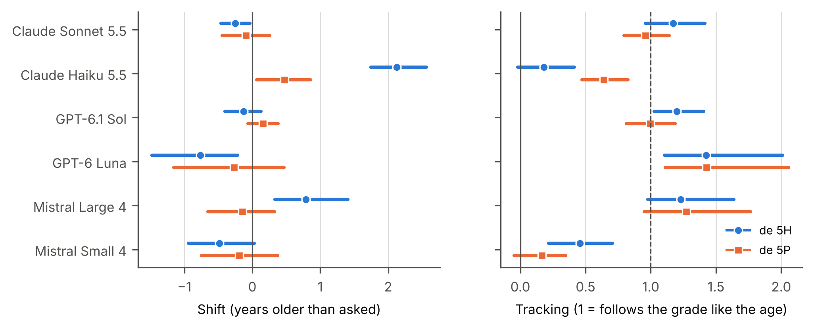

# Abstract

Teachers are advised to name their pupils' grade when they ask a language model for a reading text, but grade labels are local. In French-speaking Switzerland, grades are counted from the first year of kindergarten: « 5H » or, in Vaud and Geneva, « 5P » names pupils aged 8 to 9, two years younger than a fifth grade elsewhere. This preregistered audit asked whether six large language models from three providers write French reading texts for these labels at the same lexical demand as for the matching age. We generated 7,680 stories and informational texts for grades 3H to 8H on 16 topics and measured the mean frequency of their content words. Every model used rarer words as the requested age rose. Pooled over models, the bare HarmoS label gave texts written as for pupils 0.30 years older than the age (95% CI [0.13, 0.46]), below the smallest effect of interest, and the P label showed no difference; neither label changed how texts followed the grade. Two lighter models misread the bare labels, one writing as for pupils about two years older and hardly following the grade, and knowledge probes showed that wrong answers about the labels placed grades mostly two years too old. Adding the age to the label made the models more consistent, while naming the region made texts harder. Teachers and tool developers can keep local labels if they add the age; audits of leveled text generation should report results model by model.

# Practitioner notes

**What is already known about this topic**

- Teachers use language models to write reading texts and are advised to state the pupils' grade in the prompt.
- Studies in English found that outputs often stay above the requested grade or adapt little to the requested age.
- Grade labels differ between school systems; in French-speaking Switzerland, grades are counted from kindergarten.

**What this paper adds**

- A preregistered audit of 7,680 French reading texts from six models shows that, on average, « de 5H » and « de 5P » give texts with nearly the lexical demand of the matching age.
- Two lighter models misread the bare labels, one by about two years, which a pooled analysis would hide.
- Adding the age to the label narrowed the differences between models; naming the region made texts harder.

**Implications for practice and/or policy**

- When asking a model for a reading text, state the pupils' age, alone or after the grade label.
- Tools built for Swiss schools can map grade labels to ages before the prompt reaches the model.
- Evaluations of AI tools for teachers should report results for each model, not only on average.

# Introduction

A primary teacher in Lausanne who needs a short text about bees for tomorrow's reading lesson can now ask a chatbot for « une histoire à lire pour des élèves de 5H ». Advice written for teachers recommends exactly this: name the readers' grade in the prompt, and the model will pitch the text accordingly (Imperial & Tayyar Madabushi, 2023, p. 206). The advice assumes that the model knows what the grade means. For a label like « 5H », which belongs to the school system of French-speaking Switzerland, that assumption has not been tested.

Evidence from English-language studies is not reassuring. Asked to answer science questions for readers of different ages, ChatGPT produced answers whose readability barely moved with the requested age (Rooein et al., 2023). Asked for stories for second-grade readers, ChatGPT wrote easier stories when the grade was named, but no model reached the target range under any wording (Imperial & Tayyar Madabushi, 2023), and models asked to rewrite texts to a target Lexile level tended to overshoot it (Huang et al., 2024). These studies used United States grades, CEFR levels or Lexile scores.

School grade labels are local, and some collide. Under the HarmoS agreement, the cantons of Switzerland count school years from the first year of compulsory kindergarten, so that 5H is the third year of primary school, for pupils aged 8 to 9 (CITE HarmoS). Vaud and Geneva write the same year as 5P (CITE cantons). In France, these pupils are in CE2, while « 5e » names the second year of lower-secondary school (CITE French system). A model that reads « 5H » as the fifth year of an elementary school starting at six would write for pupils two years older, and a model that confuses it with « 5e » would miss by four years. Nothing in the text it returns would tell the teacher.

This article reports a preregistered audit of how six large language models from three providers read Swiss grade labels when they write French reading texts for primary pupils. We compared texts requested with the bare HarmoS and P labels with texts requested with the matching age, on a measure of lexical demand, the mean frequency of the content words, and asked two questions. Do the labels give texts at the same level as the age? Do they follow the grade from 3H to 8H as the age does? Variants of the label, a collision control and knowledge probes then show where the differences come from. Searches of (SEARCH SOURCES) found no earlier study of Swiss or other non-US grade labels in text generation by language models (BOUNDED NOVELTY SENTENCE TO CHECK AGAINST THE SEARCH LOG).

# Background

## Generating texts for a reading level

Studies of leveled text generation by language models agree that naming a level can move the output, but not always far enough. In the study by Imperial and Tayyar Madabushi (2023), naming the second grade lowered the Flesch–Kincaid grade level of ChatGPT's stories but left it above the target range, and describing the level brought the stories closer to it than naming the grading framework did. Rooein et al. (2023) found that the readability of ChatGPT's answers stayed within a narrow band whatever the requested age or education level, a "style" that prompting hardly moved, although another model of the same provider did respond to age. Huang et al. (2024) asked three models to rewrite texts to Lexile levels and found that a minority of outputs landed within the target band, with a skew toward harder texts. Oh et al. (2026) describe prompted grade labels as producing responses above the target grade and propose fine-tuned grade-specific models instead.

This research shares three features that limit what it says about classroom practice outside the English-speaking world. The targets are formal scales (Lexile, CEFR, United States grades) rather than the labels teachers use locally. The readability measures are formulas built for English and for the United States school system, which their own authors note may not transfer to other languages and school systems (Rooein et al., 2023). And the reference is an external target, so a model's failure to reach it cannot be separated from a disagreement about what the target means. In a European assessment context, Ripoll y Schmitz and Sonnleitner (2025) used GPT-4 to write German reading passages for fifth graders in Luxembourg and had reviewers rate them blind against passages written by people, an evaluation by human judgement rather than by a text measure.

## Measuring the lexical demand of a text

Word frequency accounts for a large share of the differences in how quickly words are recognised (Brysbaert et al., 2018), and the readers used in the first years of primary school draw on more frequent words than those of the later years (Lété et al., 2004). On the Zipf scale, frequencies are expressed as the base-10 logarithm of occurrences per billion words, so that values from 1 to 3 mark rare words and values from 4 to 6 common ones (Brysbaert et al., 2018). For French, the Lexique database gives lemma frequencies from film subtitles and from novels (New & Pallier, n.d.; New et al., 2004), and Manulex gives frequencies by grade from the readers used in French primary schools (Lété et al., 2004). Frequency is not the only source of difficulty: sentence length matters too, and for beginning readers so do decodability and information load (Huang et al., 2024; Peereman et al., 2007).

## Swiss grade labels

(SWISS SYSTEM PARAGRAPH TO WRITE FROM THE READING NOTES: HarmoS agreement, numbering 1H to 11H, school entry, P notation in Vaud and Geneva, French equivalents CP to 6e and 5e.)

# Method

## Design and preregistration

The study is an audit experiment in which the data are texts written by language models under controlled prompts; no person took part. The hypotheses, the measure, the exclusion rules, the sample size and the analyses were preregistered on AsPredicted before the confirmatory data were collected (link anonymised for review). A pilot of 252 calls to three of the models, run the day before, requested texts with the pupils' age only and served to estimate the variance and the age slope of the measure; its texts are excluded from every confirmatory analysis. The prompts, the call plan, the code, the raw outputs and the results are archived in a repository whose states at registration and at data freeze are tagged (link anonymised for review).

## Prompts and conditions

Each prompt asked in French for a reading text on a topic, for pupils of a given level: « Écris {une histoire à lire | un texte documentaire à lire} pour des élèves{label}, sur le thème {topic}. Réponds seulement avec un titre et le texte. » ("Write {a story to read | an informational text to read} for pupils{label}, on the topic {topic}. Answer only with a title and the text.") The label named the readers' level in one of eight ways (Table 1). The bare HarmoS label (L1, « de 5H ») and the bare P label (L1P, « de 5P ») are the two forms a teacher in French-speaking Switzerland is most likely to type. The age-only label (L5, « de 8 à 9 ans ») is the reference: it tells the model what the Swiss label means, so a model that understands the label should write the same kind of text under both. L2 adds the region, L3 adds the age to the H label, and L4 uses the French grade that covers the same ages. L6 is a collision control: the same digit with the suffix of the French lower-secondary grades (« de 5e »), which in France names the second year of lower-secondary school (CITE French system); it was run at 3H to 5H only, because « de 6e » is the L4 prompt of 8H. L0 gives no level and shows each model's default reader.

Table 1. The eight labels, with the wording each gives for grade 5H (pupils aged 8 to 9). The label follows « pour des élèves » in the prompt.

| Code | Wording for 5H | Role | Grades |
|---|---|---|---|
| L1 | « de 5H » | bare HarmoS label | 3H to 8H |
| L1P | « de 5P » | bare P label (Vaud, Geneva) | 3H to 8H |
| L2 | « de 5H en Suisse romande » | H label and region | 3H to 8H |
| L3 | « de 5H (8 à 9 ans) » | H label and age | 3H to 8H |
| L4 | « de CE2 » | French grade | 3H to 8H |
| L5 | « de 8 à 9 ans » | age only (reference) | 3H to 8H |
| L6 | « de 5e » | same digit, French lower-secondary suffix (collision control) | 3H to 5H |
| L0 | (none) | no level (baseline) | one text per model, genre and topic |

The labels were crossed with the six grades of the primary cycle after kindergarten (3H to 8H, pupils aged 6 to 7 up to 11 to 12), two genres (a story and an informational text) and 16 fixed topics, from bees and volcanoes to a train journey and a family celebration. Each model thus wrote 480 texts per topic, 7,680 texts in all. Each prompt was sent once, as an independent call without system prompt or conversation history, in a random order (seed 20261025), with temperature 1.0 and at most 4,000 output tokens; reasoning settings were left at each provider's default.

## Models

We audited six models, two from each of three providers: a mid-tier model and a lighter, cheaper model, as the providers' price lists placed them at the time of the study: Claude Sonnet 5.5 (claude-sonnet-5-5) and Claude Haiku 5.5 (claude-haiku-5-5) from Anthropic, GPT-6.1 Sol (gpt-6.1-sol) and GPT-6 Luna (gpt-6-luna) from OpenAI, and Mistral Large 4 (mistral-large-4-0) and Mistral Small 4 (mistral-small-2603) from Mistral AI. The identifiers are those returned by the APIs, which matched the identifiers requested for every call. All calls were made on 1 November 2026. Every model accepted the requested temperature.

## Knowledge probes

To separate what a model can state about the labels from how it writes, each model also answered 60 knowledge questions per notation, 720 in all: « À quel âge correspondent des élèves de 5H ? » ("What age are pupils in 5H?") and the same question opened by « En Suisse romande, » ("In French-speaking Switzerland,"), for the six grades in the H and P notations, five times each. As preregistered, the first age range stated in an answer counts, and it is correct if its midpoint lies within the true range widened by half a year on each side.

## Measure

The dependent variable is the mean Zipf frequency of the content lemmas of a text, a measure of lexical demand: texts for younger readers use more frequent words, which score higher. Each word form was read as its most frequent lemma in Lexique 3.83, a lexical database of contemporary French (New et al., 2004), and content words were the forms read as nouns, qualifying adjectives or verbs, without the lemmas *être* and *avoir*, the indefinites *tout*, *autre* and *même*, and proper names. A lemma's frequency is the mean of its frequencies per million words in the two corpora of Lexique, film subtitles and novels published from 1950 to 2000 (New & Pallier, n.d.), expressed on the Zipf scale, the base-10 logarithm of the frequency per billion words (van Heuven et al., 2014, as cited in Brysbaert et al., 2018). We computed it as log10(f + 0.031) + 3, so that a lemma absent from Lexique counts as frequency zero. Titles, markdown marks and lines addressed to the user rather than to the pupils (prefaces such as « Voici une histoire… » and closings such as « N'hésitez pas… ») were removed before measurement; no such line was found in the confirmatory texts (0 lines removed). The exact rules, with the test texts that pin them, are in the repository.

The measure passed two checks of validity. Before the pilot, it was run on the articles of the French Wikipedia and of Vikidia, an encyclopedia written for children, on the same 30 subjects; the preregistered criterion was met, with Vikidia scoring higher in 28 of the 29 usable pairs (sign test, one-sided *p* < .001; mean difference 0.34 Zipf). In the confirmatory data, the age-only texts of every model served as a manipulation check (H1, below). Eight secondary measures were preregistered: the median Zipf frequency of content lemmas, the shares of content lemmas below Zipf 3 and below Zipf 4, mean word length, words per sentence, number of words, the Kandel–Moles readability formula for French (CITE) and the mean Zipf frequency of word forms in films.

## Exclusions

A call that failed or returned nothing was requested once more. A text that refused the task or asked for clarification, had fewer than 20 words, or had more than 50% of its word tokens absent from Lexique was requested once more, and excluded if the second answer failed the same rule. Truncated texts, exact duplicates and answers that addressed the user outside the story were kept, flagged and removed in sensitivity analyses. No exclusion rule used the value of any frequency measure.

## Analysis

Texts were paired on model, grade, genre and topic. For topic *t* and grade *g*, *d*(*g*, *t*) is the mean over models and genres of the difference between a label's text and the age-only text. The level of a topic is the mean of *d* over the six grades, and its gradient is the least-squares slope of *d* on the midpoint of the grade's age range. A label read as an older grade gives a negative level (rarer words), and a label that the model ignores, writing at the same level whatever the grade, gives a positive gradient: too hard for the youngest pupils and too easy for the oldest. The four primary tests are two-sided one-sample *t*-tests over topics (df = 15) of the level of L1 minus L5 (H2-H) and of L1P minus L5 (H2-P), and of the gradient of L1 minus L5 (H3-H) and of L1P minus L5 (H3-P), with Holm's correction over the four tests (CITE Holm, 1979) and α = .05. Topics are the unit of inference because the texts of a topic share content that a text-level test would treat as independent; inference is conditional on these six models and this prompt wording.

The smallest effect of interest was a level difference of 0.04 Zipf, about one year of age on the planning ruler. With the pilot's residual standard deviation taken at its upper 80% confidence bound (0.122), 16 topics gave a simulated power of .835 for the H2-H level test at that difference, which fixed the number of topics before the deposit.

The manipulation check H1 asked whether, with the age only, each model's texts get rarer words as the requested age rises: per model, an ordinary least-squares regression of the measure on the age midpoint within L5, with genre and topic effects, standard errors clustered by topic and a one-sided *t*-test with 15 df.

To express effects in years, each model is read on its own age-only ruler, the least-squares line through its six L5 means, with slope *b*. For a label, the shift is the sum over models of the levels divided by the sum of the slopes, in years (positive values mean texts written as for older pupils), and the tracking is 1 plus the sum of the gradients divided by the sum of the slopes (1 means that the texts follow the grade as the age-only texts do, 0 that they ignore it). Only models with a ruler slope of at most −0.02 Zipf per year are read, a rule that all six models met. Intervals are 95% percentile intervals from 2,000 bootstrap resamples of topics. Per-model shifts and tracking, the per-grade profiles, L2 and L4, and the knowledge probes are exploratory. The preregistered secondary and sensitivity analyses are reported in the Supporting Information: the primary contrasts by ordinary least squares with model-by-grade cells and standard errors clustered by topic, on each secondary measure, with length residualised within model, without the flagged texts, and with age equivalents read on an isotonic fit of each ruler.

# Results

## Data

All 8,400 calls were answered: four probe calls to Mistral Large 4, which spent the whole output limit on reasoning and returned no text at the first pass, were answered at the second. None of the 7,680 texts was refused, too short or out of lexicon, so all were analysed; five were truncated, 11 were flagged as addressing the user and none was an exact duplicate. Texts had a mean length of 405 words (median 369), from 330 words on average for GPT-6 Luna to 594 for Claude Sonnet 5.5. The study cost 41.12 USD in API calls.

## Every model lowered word frequency with age

The manipulation check succeeded for all six models. With the age only, the mean Zipf frequency of content lemmas fell as the requested age rose, with slopes from −0.025 Zipf per year for GPT-6 Luna to −0.049 for GPT-6.1 Sol (all one-sided *p* < .001; Figure 1), and no ruler departed from a straight line (linearity tests, smallest *p* = .205). On these rulers, a difference of 0.04 Zipf is roughly one year of age.

## Bare labels: almost the age, on average

Table 2 gives the four primary tests. Texts requested with the bare HarmoS label used slightly rarer words than texts requested with the matching age (H2-H: −0.012 Zipf, 95% CI [−0.018, −0.005], *t*(15) = −3.72, *p* = .002, Holm-corrected *p* = .008). The difference is real but small: read on the models' own rulers, the « de 5H » texts were written as for pupils 0.30 years older (95% CI [0.13, 0.46]), and its confidence interval excludes the smallest effect of interest. The bare P label showed no difference (H2-P: −0.001 Zipf [−0.010, 0.009], *p* = .865); its interval excludes differences as large as the smallest effect of interest in either direction, and its shift was 0.02 years [−0.21, 0.21].

Neither label changed how texts followed the grade. The gradients of the differences were small and not significant (H3-H: 0.0027 Zipf per year [−0.0023, 0.0076], Holm *p* = .529; H3-P: 0.0040 [−0.0003, 0.0084], Holm *p* = .203). In years, the tracking of the H label was 0.93 [0.82, 1.05] and that of the P label 0.90 [0.81, 0.99]: from 3H to 8H, the P texts moved through about nine tenths of the age span that the age-only texts covered. The bootstrap interval of the P label's tracking stops just below 1 while its preregistered gradient test did not reject, so the evidence of under-tracking is weak.

Table 2. Primary tests. Levels in Zipf, gradients in Zipf per year of age; one-sample *t*-tests over 16 topics, Holm correction over the four tests. Shift: years older than the age requested; tracking: 1 = follows the grade like the age-only texts, 0 = ignores it.

| Test | Contrast | Estimate [95% CI] | *t*(15) | *p* | Holm *p* | In years [95% CI] |
|---|---|---|---|---|---|---|
| H2-H | Level, « de 5H » − age | −0.012 [−0.018, −0.005] | −3.72 | .002 | .008 | shift 0.30 [0.13, 0.46] |
| H2-P | Level, « de 5P » − age | −0.001 [−0.010, 0.009] | −0.17 | .865 | .865 | shift 0.02 [−0.21, 0.21] |
| H3-H | Gradient, « de 5H » − age | 0.0027 [−0.0023, 0.0076] | 1.16 | .264 | .529 | tracking 0.93 [0.82, 1.05] |
| H3-P | Gradient, « de 5P » − age | 0.0040 [−0.0003, 0.0084] | 1.97 | .068 | .203 | tracking 0.90 [0.81, 0.99] |

## The wording around the label moved the texts more than the label itself

The other wordings, exploratory except for L3, moved the texts further (Figure 2). Adding « en Suisse romande » to the H label made the texts older, with a shift of 0.87 years [0.54, 1.23], whereas adding the age in brackets made them younger than the age alone, with a shift of −0.46 years [−0.62, −0.33]; the L3 texts had more frequent words than both the age-only texts (0.018 Zipf, *p* < .001) and the bare-label texts (0.030 Zipf, *p* < .001). The French grades kept the level close to the age (−0.26 years [−0.45, −0.08]) but stretched the grade span, with a tracking of 1.32 [1.22, 1.45]: CP texts were easier and 6e texts harder than the texts for the same ages.

The collision control behaved as a misreading should. Asked for « élèves de 3e », « de 4e » or « de 5e », the models wrote texts 5.62 years older than for the ages meant by 3H to 5H [5.31, 5.99], that is, for French lower-secondary pupils, with a negative tracking (−0.92) because 3e is the oldest of these grades in France. Without any level, the models wrote for pupils of 9.4 to 11.7 years on their own rulers.

## Two smaller models did not follow the bare labels

The averages hide a split between models (Figure 3, exploratory). Four models followed the bare H label at least as steeply as the age, with point estimates of tracking between 1.17 and 1.42. Claude Haiku 5.5 wrote its « de 5H » texts as for pupils 2.12 years older [1.75, 2.56] and hardly followed the grade (tracking 0.18 [−0.02, 0.41]); with the P label its shift fell to 0.48 years and its tracking rose to 0.64. Mistral Small 4 followed neither label well (tracking 0.46 for H and 0.16 for P): compared with its own age-only texts, its labelled texts were too hard for the youngest grades and too easy for the oldest.

The knowledge probes add a second view (Table 3). Claude Sonnet 5.5, GPT-6.1 Sol and GPT-6 Luna gave the correct age for nearly every H and P grade, whereas Claude Haiku 5.5, Mistral Large 4 and Mistral Small 4 were right for 65%, 62% and 37% of the H grades. Their errors were almost all too old: on average, Claude Haiku 5.5 placed an H grade 1.62 years above its true age and Mistral Small 4 0.97 years above. For two of these three models, the probes and the texts erred in the same direction: Claude Haiku 5.5 and Mistral Large 4 also wrote their « de 5H » texts as for older pupils (shifts of 2.12 and 0.79 years). Mistral Large 4 nonetheless followed the grades (tracking 1.23) although it misplaced more than a third of the H grades in the probes, and Mistral Small 4, which placed grades too old, wrote its « de 5H » texts slightly younger on average (shift −0.49 years). In these six models, what a model stated about a label and how it wrote for it went together in some cases and not in others.

Table 3. Model by model: slope of the age-only ruler (H1), age at which each model writes without a level (L0, read on its ruler), and knowledge probes (60 per notation and model; correct when the midpoint of the first age range stated lies within the true range widened by half a year; error = midpoint stated minus true midpoint, positive when too old). Exploratory except the slopes.

| Model | Ruler slope (Zipf per year) | Default age, no level (years) | Probes correct, H (%) | Probes correct, P (%) | Mean probe error, H (years) | Mean probe error, P (years) |
|---|---|---|---|---|---|---|
| Claude Sonnet 5.5 | −0.045 | 10.5 | 100 | 98 | −0.14 | −0.13 |
| Claude Haiku 5.5 | −0.043 | 11.3 | 65 | 58 | 1.62 | 1.04 |
| GPT-6.1 Sol | −0.049 | 10.5 | 100 | 100 | 0.00 | 0.00 |
| GPT-6 Luna | −0.025 | 9.4 | 100 | 95 | 0.00 | 0.10 |
| Mistral Large 4 | −0.041 | 11.2 | 62 | 55 | 0.79 | 0.68 |
| Mistral Small 4 | −0.034 | 11.7 | 37 | 33 | 0.97 | 1.21 |

## Sensitivity analyses

The primary results did not depend on the analytic choices preregistered as sensitivity analyses (Supporting Information, Table S1). Removing the truncated, duplicated or flagged texts changed no estimate by more than 0.0002 Zipf, the regression with errors clustered by topic gave the same estimates with *p*-values within .005 of the topic-level tests, and reading the rulers through an isotonic fit gave shifts of 0.19 years for the H label and −0.05 for the P label. Residualising length within model enlarged the H level difference (−0.017 Zipf, *p* < .001) and left the other three tests non-significant. Both bare labels gave texts shorter than the age-only texts, by about 35 words on average (Table S2).

# Discussion

## A local label is mostly understood, on average

The question was whether naming the grade with a Swiss label gives reading texts of the same lexical demand as giving the pupils' age. Averaged over six current models, the answer is close to yes. The bare HarmoS label produced slightly rarer words than the age, a shift of about a third of a year that lies below the difference we had set in advance as the smallest worth detecting, and the bare P label of Vaud and Geneva produced no detectable difference. Neither label weakened how the texts followed the grade from 3H to 8H. The labels are not a large source of mis-levelled texts when results are pooled over models.

This contrasts with earlier audits in English, where prompting for an age or a grade changed the readability of the outputs little or left it above the target (Imperial & Tayyar Madabushi, 2023; Rooein et al., 2023). Here every model lowered word frequency as the requested age rose. The difference may come from newer models, from the genre (reading texts rather than answers to questions), from the measure (lemma frequency rather than surface formulas) or from the language, and our design cannot separate these. Our reference also differs: we compared each label with the text the same model writes for the matching age, so we can say whether a label is read as its age, not whether either text is right for real pupils of that age.

## The average hides models that misread the label

A teacher does not meet an average; each tool runs on one model. Two of the six models, both the lighter model of their provider, did not follow the bare labels. Claude Haiku 5.5 wrote « de 5H » texts as for pupils about two years older and barely varied them with the grade; Mistral Small 4 varied its labelled texts across grades much less than its age-only texts. For a 3H class, texts of this kind are harder than the age would give, and for an 8H class they are easier.

The knowledge probes suggest where such errors come from. Of the 177 wrong answers, 86% placed the grade 1.5 to 2.5 years too old. That is the error of reading the digit as the year of a primary school that starts the year pupils turn six: the fifth year of the French école élémentaire is CM2, the grade of pupils aged 10 to 11, two years above 5H (CITE French system). This reading fits Claude Haiku 5.5 and Mistral Large 4, whose texts and probe answers erred in the same direction, but not Mistral Small 4, whose probe answers were too old while its labelled texts were, on average, slightly younger. A quick question to a model about the age of a grade is therefore a weak screen: in this sample, the models that stated the right ages also wrote texts that matched the age, but a wrong answer did not predict how the texts would go wrong.

## The words around the label matter as much as the label

Wordings that a teacher might use to be helpful moved the texts more than the bare labels did. Naming the region made texts harder by almost a year, an effect we did not predict and cannot explain from these data. Adding the age to the label made texts slightly easier than the age alone and, in exploratory per-model estimates, brought the models closer together: with the gloss, per-model shifts ranged from −0.96 to −0.11 years and tracking from 0.75 to 1.30, against −0.77 to 2.12 years and 0.18 to 1.42 with the bare H label. The French grade names kept the average level but stretched the span between CP and 6e, as if they carried stronger associations with the first year of reading and with secondary school than the matching ages do. The collision control shows how far a label can mislead when its digit is read in another system: « de 5e » moved texts by more than five years.

## Implications

For teachers, the practical rule is simple: state the age, alone or after the label (« pour des élèves de 5H (8 à 9 ans) »), which gave the most consistent texts across models. The bare labels are acceptable with the larger models audited here, but a teacher cannot always tell which model a tool runs on. For the developers of tools for Swiss schools, the same rule can be applied before the prompt reaches the model, by mapping the label to its ages. For research on generative AI in education, the results show that audits of leveled text generation should report results by model, because pooled estimates can hide models that fail, and that model-internal age equivalents give a scale on which label wordings, models and languages can be compared.

## Limitations

The measure covers one dimension of text difficulty: sentence length matters too, and for beginning readers so do decodability and information load (Huang et al., 2024). The frequencies come from Lexique, whose corpora are films and novels for adults; grade-level norms from French school readers exist (Lété et al., 2004), and adult-based norms are a weaker guide to what children have met in print (Peereman et al., 2007). The reference is each model's own idea of an age, so the study shows equivalence between wordings, not appropriateness for pupils, and no teacher or pupil judged the texts (compare Ripoll y Schmitz & Sonnleitner, 2025). Each condition was sampled once per topic and genre, in French, with one prompt template and a temperature of 1.0; other wordings, conversation histories or settings could behave differently. The models were those available on 1 November 2026, and providers update them; the code and prompts are public so that the audit can be repeated. The study was powered for the pooled tests, and the per-model estimates are exploratory, with wide intervals for some models. Finally, the study was designed, run and written with an AI assistant made by one of the audited providers; the analyses were preregistered, the code that produced every number is public and the checks were scripted, which limits but does not remove the risk this poses.

# Conclusion

Swiss teachers can name a grade the way they do in class, « de 5H » or « de 5P », and most current large models will write a reading text at about the lexical level of the matching age. Not every model does: two lighter models misread the bare labels, one by about two years. Adding the age to the label narrowed the differences between models, which makes it the wording to recommend in teacher education and to build into classroom tools.

# Statements

**Data availability.** The prompts, call plans, raw model outputs with their SHA-256 hashes, analysis code, results and the scripts that check every number of this article are available in the study repository (link anonymised for review; it will be archived with a DOI on acceptance).

**Preregistration.** The hypotheses, measure, exclusion rules, sample size and analyses were preregistered on AsPredicted on 1 November 2026, before the confirmatory data were collected (link anonymised for review). The Supporting Information (S1) lists where each preregistered analysis is reported; there were no deviations.

**Ethics.** The study involved no human participants and no personal data: its data are texts generated by language models through their public APIs. No ethical approval was required.

**Conflicts of interest.** AUTHOR INPUT: the author declares no conflict of interest (to confirm).

**Funding.** AUTHOR INPUT: no specific funding (to confirm). The API calls cost 41.12 USD for the main study and 2.26 USD for the pilot. The OpenAI and Mistral calls were paid by the author; the Anthropic calls were paid from API credits attached to the author's account (wording to confirm).

**Use of generative AI.** This study was conceived and designed with the assistance of Claude Opus 5.5 (claude-opus-5-5, Anthropic), which also searched and summarised the literature, wrote the code for data collection and analysis, drafted the manuscript and ran internal error checks. Anthropic is one of the three providers whose models were audited. The outputs of the six audited models were generated as the research data of this study; the prompts, parameters and outputs are archived in the repository. Reference and number checks were performed by scripted tools and by separate AI sessions, whose reports the author reviewed. The author approved the study design before data collection, reviewed and edited the full manuscript, and takes full responsibility for its content.

# References

Brysbaert, M., Mandera, P., & Keuleers, E. (2018). The word frequency effect in word processing: An updated review. *Current Directions in Psychological Science, 27*(1), 45–50. https://doi.org/10.1177/0963721417727521

Huang, C.-Y., Wei, J., & Huang, T.-H. K. (2024). *Generating educational materials with different levels of readability using LLMs* (arXiv:2406.12787). arXiv. https://doi.org/10.48550/arXiv.2406.12787

Imperial, J. M., & Tayyar Madabushi, H. (2023). Flesch or fumble? Evaluating readability standard alignment of instruction-tuned language models. In *Proceedings of the Third Workshop on Natural Language Generation, Evaluation, and Metrics (GEM)* (pp. 205–223). Association for Computational Linguistics. https://aclanthology.org/2023.gem-1.18/

Lété, B., Sprenger-Charolles, L., & Colé, P. (2004). MANULEX: A grade-level lexical database from French elementary school readers. *Behavior Research Methods, Instruments, & Computers, 36*(1), 156–166. https://doi.org/10.3758/BF03195560

New, B., & Pallier, C. (n.d.). *Manuel de Lexique 3* (Version 3.2) [Documentation]. Lexique.org. https://lexique.org/_documentation/Manuel_Lexique.3.2.pdf

New, B., Pallier, C., Brysbaert, M., & Ferrand, L. (2004). Lexique 2: A new French lexical database. *Behavior Research Methods, Instruments, & Computers, 36*(3), 516–524. https://doi.org/10.3758/BF03195598

Oh, J., Whang, S. E., Evans, J., & Wang, J. (2026). Classroom AI: Large language models as grade-specific teachers. *npj Artificial Intelligence, 2*(1), Article 28. https://doi.org/10.1038/s44387-026-00081-7

Peereman, R., Lété, B., & Sprenger-Charolles, L. (2007). Manulex-infra: Distributional characteristics of grapheme–phoneme mappings, and infralexical and lexical units in child-directed written material. *Behavior Research Methods, 39*(3), 579–589. https://doi.org/10.3758/BF03193029

Ripoll y Schmitz, L. M., & Sonnleitner, P. (2025). Evaluating AI-generated vs. human-written reading comprehension passages: An expert SWOT analysis and comparative study for an educational large-scale assessment. *Large-Scale Assessments in Education, 13*, Article 20. https://doi.org/10.1186/s40536-025-00255-w

Rooein, D., Cercas Curry, A., & Hovy, D. (2023). *Know your audience: Do LLMs adapt to different age and education levels?* (arXiv:2312.02065). arXiv. https://doi.org/10.48550/arXiv.2312.02065
