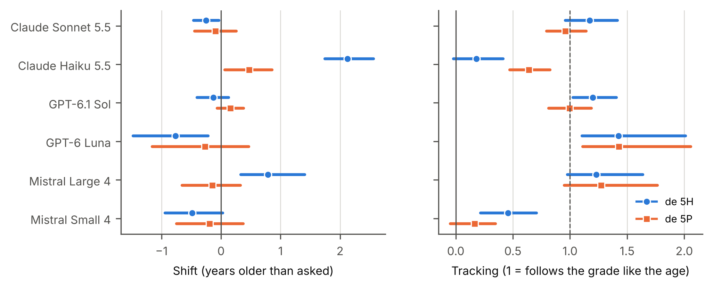

# Abstract

Teachers are advised to name their pupils' grade when they ask a language model for a reading text, but grade labels are local. In French-speaking Switzerland, grades are counted from the first year of kindergarten, so « 5H » or « 5P » names pupils aged 8 to 9, two years younger than the fifth year of primary school in France. This preregistered audit asked whether six large language models from three providers write French reading texts for these labels at the lexical demand they give the matching age. The measure, the mean frequency of content words in 7,680 texts for grades 3H to 8H, was read on each model's own scale of texts requested by age (model-internal years). Pooled over the six models, the bare HarmoS label gave texts written as for pupils 0.30 model-internal years older (95% CI [0.13, 0.46]), a difference that rested on one model, and the P label showed no detectable difference. In exploratory analyses, models departed from their age-only texts in both directions, one lighter model by about two years, and with the age added to the label every model stayed within a year. Rescored post hoc with frequencies from French primary-school readers, these results held, and at least five of the six models used more frequent words than the readers of the matching grade. [Author: one or two sentences of conclusion.]

**Keywords:** generative AI, large language models, localization, grade labels, reading texts, primary education

# Manuscript synopsis {.unnumbered}

Purpose: to test whether the grade labels used in French-speaking Switzerland, which count school years from the first year of kindergarten, lead language models to write reading texts at the lexical demand of the pupils' age. Regional context: teachers in the region prompt in French, the language of a larger neighbour that counts school years differently, and use tools built outside the region. Method: a preregistered audit of 7,680 French reading texts written by six models of three providers, comparing each label with the same model's texts for the matching age, with variants of the label, a collision control, knowledge probes and a post hoc comparison with French primary-school readers. Findings: the bare HarmoS label gave texts for slightly older pupils on average, a difference resting on one model, and the bare P label gave no detectable difference. Individual models departed in both directions, and adding the age kept every model within a year of its age-only texts. [Author: contribution and implications for teachers, tool developers and researchers in the region, in two or three sentences.]

# Introduction

A primary teacher in Fribourg who needs a short text about bees for tomorrow's reading lesson can now ask a chatbot for « une histoire à lire pour des élèves de 5H ». Teachers in the region have begun to use such tools: in a survey of teachers of Vaud's public upper-secondary schools and private schools, about half had used ChatGPT, and a quarter of these had used it in their teaching, mainly to prepare lessons (Avry, 2023). How teachers word their requests matters: prospective primary teachers in Germany who had been trained both in the subject and in prompting obtained highly viable tasks from ChatGPT, whereas untrained ones mostly did not (Kuzu et al., 2025). Guidance for teachers, as described by Imperial and Tayyar Madabushi (2023, p. 206), recommends naming the readers' grade in the prompt, which assumes that the model knows what the grade means.

Evidence from English-language studies is not reassuring: the readability of ChatGPT's answers barely moved with the requested age (Rooein et al., 2023), and generated texts often stayed above the requested grade or level (Huang et al., 2024; Imperial & Tayyar Madabushi, 2023). These studies used United States grades, CEFR levels or Lexile scores.

School grade labels are local, and some collide. Under the intercantonal HarmoS agreement, children in the cantons that joined it start school once they are four years old on 31 July, and the primary degree lasts eight years, kindergarten included (CDIP, 2007). Fribourg numbers the school years 1H to 11H (Canton de Fribourg, 2025), Vaud and Geneva write the primary years 1P to 8P (État de Vaud, n.d.; République et canton de Genève, 2026), and all three place 5H or 5P at the start of a cycle for pupils aged 8 to 12: a pupil who has neither repeated nor skipped a year is 8 or 9 in 5H. In France, where the école élémentaire runs from CP to CM2 for children aged 6 to 11 (Ministère de l'Éducation nationale, 2024a), that is the age of its third class, CE2, for a child who starts CP at six, and « 5e » names the second of the four years of lower-secondary school (Ministère de l'Éducation nationale, 2024b). Vaud itself counted its school years from two years later than HarmoS until 2013, when its sixth year became 8H (État de Vaud, 2012). A model that reads « 5H » as the fifth year of a primary school starting at six would write for pupils two years older, and one that confuses it with « 5e » would miss by four years. The problem is not specifically Swiss. Dutch children may also start primary school at four (Rijksoverheid, n.d.), whereas French-speaking Belgium, which writes its primary years P1 to P6, and Québec start the primary years at six (Fédération Wallonie-Bruxelles, 2025, p. 8; Gouvernement du Québec, n.d.), so that their fifth primary year holds pupils about a year and a half to two years older than « 5P » in Vaud. Wherever school years are counted from another starting point, the same grade number names a different age.

A grade label is thus an indirect specification of the reader, and a piece of regional knowledge: it works only if the model maps the label to the age the teacher means. Whether it does is a question about the cultural defaults of the tools teachers use as much as about prompting (see Background). Three questions follow, and the design keeps them apart: whether a model writes differently for different ages at all, which gives each model its own ruler; whether a label moves its texts as the matching age does, which is equivalence with the model's own age-only texts; and whether the model can say which age a label names.

This article reports a preregistered audit of how six large language models from three providers read Swiss grade labels when they write French reading texts. It compares texts requested with the bare HarmoS and P labels with texts requested with the matching age, on a measure of lexical demand, and asks whether the labels give texts at the same level as the age and follow the grade from 3H to 8H as the age does. Variants of the label, a collision control and knowledge probes then show where differences come from, and a post hoc comparison with French primary-school readers places the texts on a scale that does not depend on the models. The searches logged for this study, in English and French, found no earlier study of how language models read Swiss school grade labels (search log in the repository).

# Background

## Cultural defaults and local conventions

Language models learn from text that over-represents some parts of the world, and their outputs carry the defaults of those parts (Tao et al., 2024). Asked the questions of an international values survey, five successive models answered like people from English-speaking and Protestant European countries. Naming a country in the prompt brought the answers closer to that country's survey values for most countries, but with the most recent of these models it moved them further away for several European countries whose values were already close to the default, Switzerland among them (Tao et al., 2024). Everyday knowledge shows a related pattern: models answer everyday questions less well for cultures that are less represented online (Myung et al., 2024). Grade labels belong to yet another layer, the institutional conventions of a school system, which a teacher's prompt takes for granted. Teachers in French-speaking Switzerland write their prompts in the language of a much larger neighbour whose school years are counted differently, and the tools they use are built outside the region and evaluated mostly on other school systems (next section). Whether a model reads a local label in local terms or through the conventions of that neighbour decides who has to do the work of translation, the tool or the teacher, and an audit of local labels makes that work visible.

## Generating texts for a reading level

Studies of leveled text generation find that naming a level moves the output of some models, but rarely far enough. Naming the second grade lowered the Flesch–Kincaid grade level of ChatGPT's story continuations but left it above the target range, and describing the scale in the prompt helped more than naming the grading framework (Imperial & Tayyar Madabushi, 2023). The readability of ChatGPT's answers stayed within a narrow band whatever the requested age or education level, while another model of the same provider responded slightly to age (Rooein et al., 2023). When three models wrote stories for preschoolers, naming the child's age made little difference to the age of acquisition of their words (Valentini et al., 2023). When three models rewrote texts to Lexile levels, a minority of outputs landed within the target band, with a skew toward harder texts (Huang et al., 2024), and prompted grade labels have been described as producing responses above the target grade (Oh et al., 2026).

This research says little about classroom practice outside the English-speaking world. Its targets are formal scales rather than the labels teachers use locally. Its most used measures, the Flesch–Kincaid reading ease and grade level, are formulas built for English and for the United States school system, which Rooein et al. (2023) note are unlikely to transfer without adaptation. Finally, its reference is an external target, so a model's failure to reach it cannot be separated from a disagreement about what the target means. In a European assessment context, Ripoll y Schmitz and Sonnleitner (2025) used GPT-4 to write German reading passages for fifth graders in Luxembourg and had teachers, test developers and other native speakers rate them blind against passages written by people.

## Lexical demand and young readers

Vocabulary is one of the levers of text difficulty. When narrative and scientific texts for second graders in France were simplified, chiefly at the lexical and syntactic levels and with long and infrequent words replaced by shorter and more frequent synonyms, the children read them more fluently and understood them better, and poor readers benefited most (Javourey-Drevet et al., 2022). Word frequency accounts for a large share of the differences in how quickly words are recognised (Brysbaert et al., 2018), and in English, mean word frequency, concreteness and age of acquisition together explained about a third of the variance in teachers' judgements of the readability of text excerpts (Trott & Rivière, 2024). In French, the readers used in the first years of primary school draw on more frequent words than those of the later years (Lété et al., 2004). On the Zipf scale, frequencies are the base-10 logarithm of occurrences per billion words, so that values from 1 to 3 mark rare words and values from 4 to 6 common ones (Brysbaert et al., 2018). The French database Lexique gives lemma frequencies from novels and, since its third version, from film subtitles (New et al., 2004; New & Pallier, n.d.). Frequency is not the only source of difficulty: for beginning readers decodability matters too (Peereman et al., 2007), and so do sentence length and information load (Huang et al., 2024).

# Method

## Design and preregistration

The study is an audit experiment in which the data are texts written by language models under controlled prompts, and no person took part. The hypotheses, the measure, the exclusion rules, the sample size and the analyses were preregistered on AsPredicted before the confirmatory data were collected (link anonymised for review). Supporting Information S1 gives the times, where each registered analysis is reported, the two departures from the registration and the analyses added after the data were seen. A pilot of 252 calls to three of the models, run the day before, requested 216 texts with the pupils' age only, on six of the 16 topics, and 36 knowledge probes, to estimate the variance and the age slope of the measure and to check the probe parser. None of its outputs enters any confirmatory analysis. The prompts, the code, the raw outputs and the results are archived in a repository whose states at registration and at data freeze are tagged (link anonymised for review).

## Prompts and conditions

Each prompt asked in French for a reading text on a topic, for pupils of a given level: « Écris {une histoire à lire | un texte documentaire à lire} pour des élèves{label}, sur le thème {topic}. Réponds seulement avec un titre et le texte. » ("Write {a story to read | an informational text to read} for pupils{label}, on the topic {topic}. Answer only with a title and the text.") The label named the level in one of eight ways (Table 1): the bare HarmoS label (L1, « de 5H ») and the bare P label (L1P, « de 5P ») are the cantonal notations cited above, and the age-only label (L5, « de 8 à 9 ans ») is the reference. The study asks whether a label gives texts of the same lexical demand as the matching age, which is what a teacher who names the grade expects. A label can also change a text by evoking school or a country, so a departure from the age-only texts does not by itself show a misreading. L6, a collision control, uses the suffix of the French lower-secondary grades (« de 5e ») at 3H to 5H only, because « de 6e » is the L4 prompt of 8H. L0 gives no level and shows each model's default reader.

Table 1. The eight labels, with the wording each gives for grade 5H (pupils aged 8 to 9). The label follows « pour des élèves » in the prompt.

| Code | Wording for 5H | Role | Grades |
|---|---|---|---|
| L1 | « de 5H » | bare HarmoS label | 3H to 8H |
| L1P | « de 5P » | bare P label (Vaud, Geneva) | 3H to 8H |
| L2 | « de 5H en Suisse romande » | H label and region | 3H to 8H |
| L3 | « de 5H (8 à 9 ans) » | H label and age | 3H to 8H |
| L4 | « de CE2 » | French grade | 3H to 8H |
| L5 | « de 8 à 9 ans » | age only (reference) | 3H to 8H |
| L6 | « de 5e » | same digit, French lower-secondary suffix (collision control) | 3H to 5H |
| L0 | (none) | no level (baseline) | one text per model, genre and topic |

The labels were crossed with the six grades of the primary cycle after kindergarten (3H to 8H, pupils aged 6 to 7 up to 11 to 12), two genres (a story and an informational text) and 16 topics fixed before the pilot. Each topic thus received 480 texts, 80 from each model, 7,680 in all. Each prompt was sent once, as an independent call through the providers' APIs, without system prompt or conversation history, in a random order (seed 20261025), with temperature 1.0 and at most 4,000 output tokens, and reasoning settings were left at each provider's default.

## Models

The audit covered six models, two from each of three providers, a mid-priced model and the provider's cheaper, lighter model (the lighter models below), as the providers' price lists placed them at the time: Claude Sonnet 5.5 (claude-sonnet-5-5) and Claude Haiku 5.5 (claude-haiku-5-5) from Anthropic, GPT-6.1 Sol (gpt-6.1-sol) and GPT-6 Luna (gpt-6-luna) from OpenAI, and Mistral Large 4 (mistral-large-4-0) and Mistral Small 4 (mistral-small-2603) from Mistral AI. The identifiers returned by the APIs matched those requested. All but mistral-small-2603 are aliases without a date, so the models behind them may change. All calls were made on 1 November 2026, and every model accepted the requested temperature. Other sampling parameters, such as top_p, were left at each provider's default. Default reasoning differed: Mistral Large 4 reasoned before every text and Mistral Small 4 before none, and Claude Haiku 5.5 reasoned before 57% to 92% of its texts with a Swiss label but before at most 2% with an age or a French grade (Table S9).

## Knowledge probes

Each model also answered 60 knowledge questions per notation, 720 in all: « À quel âge correspondent des élèves de 5H ? » ("What age are pupils in 5H?") and the same question opened by « En Suisse romande, » ("In French-speaking Switzerland,"), for the six grades in the H and P notations, five times each. As preregistered, the first age range stated in an answer counts, and it is correct if its midpoint lies within the true range widened by half a year on each side. Of the answers, 77% stated more than one range.

## Measure

The dependent variable is the mean, over the content words of a text, of the Zipf frequency of their lemmas, a measure of lexical demand: texts for younger readers use more frequent words, which score higher. Each word form was read as its most frequent lemma in Lexique 3.83, the version fixed in the preregistration (Supporting Information S1), and content words were the forms read as nouns, qualifying adjectives or verbs, without the lemmas *être* and *avoir*, the indefinites *tout*, *autre* and *même*, and proper names. A lemma's frequency was the mean of its two frequencies per million words in Lexique, from film subtitles and from novels published from 1950 to 2000 (New & Pallier, n.d.), expressed on the Zipf scale (van Heuven et al., 2014, as cited in Brysbaert et al., 2018) as log10(f + 0.031) + 3. As preregistered, a word absent from Lexique that is not a proper name counts as a content word of frequency zero (0.53% of content words; see Sensitivity analyses). Like its earlier version, which Peereman et al. (2007) counted among the databases built from material for adults, Lexique does not describe what children read, and words of Swiss French usage may be rarer in its corpora than in Swiss texts. A single scale was needed for all six grades, however, and Manulex, the grade-level database built from French school readers, gives frequencies for the classes from CP to CM2 in three levels (Lété et al., 2004) and does not reach 8H. Titles, markdown and lines addressed to the user were removed before measurement, and the rules and the test texts that pin them are in the repository.

The measure passed a check of validity before the pilot: on the articles of the French Wikipedia and of Vikidia, an online encyclopedia for readers aged 8 to 13 (Vikidia, n.d.), on the same 30 subjects, Vikidia scored higher in 28 of the 29 usable pairs, as the preregistered criterion required (sign test, one-sided *p* < .001; mean difference 0.34 Zipf). This shows that the measure separates texts written for children from texts written for adults; whether it resolves a single year of age rests on the models' own age-only texts (Results). Eight secondary measures were preregistered, among them the Kandel–Moles adaptation of the Flesch readability formula to French (Kandel & Moles, 1958, as cited in Primpied et al., 2022; Supporting Information S1 and Table S2).

## Exclusions

A call that failed or returned nothing was requested once more. A text that refused the task or asked for clarification, had fewer than 20 words, or had more than 50% of its word tokens absent from Lexique was requested once more, and excluded if the second answer failed the same rule. Truncated texts, exact duplicates and answers that addressed the user were kept, flagged and removed in sensitivity analyses. No exclusion rule used the value of any frequency measure.

## Analysis

Texts were paired on model, grade, genre and topic. For topic *t* and grade *g*, *d*(*g*, *t*) is the mean over models and genres of the difference between a label's text and the age-only text. The level of a topic is the mean of *d* over the six grades, and its gradient is the least-squares slope of *d* on the midpoint of the grade's age range. A label read as an older grade gives a negative level (rarer words), and a label that the model ignores gives a positive gradient. The four primary tests are two-sided one-sample *t*-tests over topics (df = 15) of the level and of the gradient of L1 minus L5 (H2-H, H3-H) and of L1P minus L5 (H2-P, H3-P), with Holm's correction and α = .05. Topics are the unit of inference because the texts of a topic share content, and inference is conditional on these six models and this prompt wording.

The smallest effect of interest was a level difference of 0.04 Zipf (content words about 9% less frequent in geometric mean), about one year of age on the planning ruler. With the pilot's residual standard deviation at its upper 80% confidence bound (0.122), 16 topics gave a simulated power of .835 for the H2-H test at that difference (other assumptions in Supporting Information S1). For the gradient tests, the same simulations gave a power of .90 to detect a halving of the age gradient at a residual standard deviation of 0.15, so smaller departures could go undetected.

The manipulation check H1 regressed, per model, the measure of the age-only texts on the age midpoint, with genre and topic effects and standard errors clustered by topic (one-sided *t*-test). To express effects in years, each model is read on its own age-only ruler, the least-squares line through its six L5 means, with slope *b*. A model-internal year is the change in that model's age-only texts from one year of age to the next. For a label, the shift is the sum over models of the levels divided by the sum of the slopes (positive values mean texts written as for older pupils), and the tracking is 1 plus the sum of the gradients divided by the sum of the slopes (1 means that the texts follow the grade as the age-only texts do). All six models met the eligibility rule of a slope of at most −0.02 Zipf per year. Intervals are 95% percentile intervals from 2,000 bootstrap resamples of topics. Per-model estimates, per-grade profiles, L2, L4, the summary by provider and model size and the probes are exploratory, as preregistered, and are not corrected for multiple comparisons. Analyses added after the data were seen, prompted by internal readings of a draft, are labelled post hoc (Supporting Information S1). The analyses were run in Python with NumPy, pandas, SciPy and statsmodels, at the versions listed in the repository.

## Child-based norms (post hoc)

Because Lexique describes what adults read, the texts were also compared with what children read, after the data had been seen. Manulex gives lemma frequencies from the 1.9 million words of 54 French primary-school readers, chosen by their sales in 1996, separately for CP, CE1 and CE2 to CM2 (Lété et al., 2004). Three analyses used its lemma table as distributed by Open Lexicon (checksum in the repository). First, the content lemmas of the readers of each level, with the categories and exclusions of the measure, were scored with their Lexique frequency, which places the readers on the study's scale as a token-weighted mean. Second, every text was scored again with the same content tokens, each lemma taking its Manulex frequency over all grades, a lemma absent from Manulex counting as frequency zero, and the primary tests, rulers, shifts and tracking were rerun on this measure. Third, coverage was the share of a text's content tokens attested in the readers of the level that matches the requested grade: CP for 3H, CE1 for 4H and CE2 to CM2 for 5H to 7H (Manulex has no level for 8H). The script, exploratory_manulex.py, ran in the repository's workflow on the registered lexicon.

## Use of an AI assistant

[Author: rewrite this paragraph, the declaration on the title page and the author contributions so that they say who wrote the interpretation in this version. See the brief.]

The author chose the topic, set the rules of a written protocol for AI-assisted research, which was drafted with an AI assistant, took the design decisions, approved the design before data collection and the manuscript before submission, wrote the advice to teachers in the Implications, and is accountable for the work. Under that protocol the assistant (Claude Opus 5.5, claude-opus-5-5) searched the literature, designed the study in detail, wrote the preregistration text and the code for data collection and analysis, ran both through the repository's automated workflows and drafted the rest of the manuscript. The following features let a reader check the assistant's work. The hypotheses, the measure and the analyses were registered before the confirmatory data were collected. Every number in the text is filled in by script from the archived results or from a file of process facts with their sources. The prompts, the raw outputs, the code and the scripts that check the numbers are archived in the repository. Separate sessions of Claude models reviewed the design, the code and the text, which is not an independent review (see Limitations). The statement on the use of generative AI, provided on the title page during review, sums up who did what.

# Results

## Data

All 8,400 calls were answered: four probe calls to Mistral Large 4, which spent the whole output limit on reasoning at the first pass, were answered at the second. None of the 7,680 texts was refused, too short or out of lexicon, so all were analysed. Of these, five were truncated, 11 were flagged as addressing the user and none was an exact duplicate. Texts had a mean length of 405 words (median 369), from 330 on average for GPT-6 Luna to 594 for Claude Sonnet 5.5.

## Every model lowered word frequency with age

The manipulation check succeeded for all six models. With the age only, the mean Zipf frequency of content lemmas fell as the requested age rose, with slopes from −0.025 Zipf per year for GPT-6 Luna to −0.049 for GPT-6.1 Sol (all one-sided *p* < .001; Figure 1), and the linearity tests showed no evidence of departure from a straight line (smallest *p* = .205). The models also differed at the same requested age: depending on the grade, their age-only texts were 0.14 to 0.23 Zipf apart, about as much as one model's texts changed from 3H to 8H (0.12 to 0.24 Zipf; post hoc).

## Bare labels: almost the age, on average (confirmatory)

Texts requested with the bare HarmoS label used slightly rarer words than texts requested with the matching age (Table 2; H2-H: −0.012 Zipf, content words about 3% less frequent in geometric mean, 95% CI [−0.018, −0.005], *t*(15) = −3.72, *p* = .002, Holm-corrected *p* = .008). Read on the models' own rulers, the « de 5H » texts were written as for pupils 0.30 years older [0.13, 0.46]. This difference rests on one model: without Claude Haiku 5.5, it was 0.0041 Zipf (*p* = .297; Table S10, post hoc). The bare P label showed no detectable difference (H2-P: −0.001 Zipf [−0.010, 0.009], *p* = .865; shift 0.02 years [−0.21, 0.21]). Both intervals lie within ±0.04 Zipf, a wide margin of 0.8 to 1.6 model-internal years, in a post hoc equivalence reading: the preregistration set this difference for the power analysis, not as an equivalence margin. The secondary measures did not all agree (Table S2, uncorrected tests): the H label's difference did not appear in the frequency of word forms, and the P texts had slightly more frequent word forms, shorter sentences and higher Kandel–Moles scores than the age-only texts.

The pooled gradients were small and not significant (H3-H: 0.0027 Zipf per year [−0.0023, 0.0076], Holm *p* = .529; H3-P: 0.0040 [−0.0003, 0.0084], Holm *p* = .203), so no change in how texts followed the grade was detected. The tracking of the H label was 0.93 [0.82, 1.05] and that of the P label 0.90 [0.81, 0.99]. With 100,000 resamples instead of the registered 2,000, the latter interval is [0.81, 1.00] (post hoc), so the evidence of under-tracking is weak.

Table 2. Primary tests. Levels in Zipf, gradients in Zipf per year of age; one-sample *t*-tests over 16 topics, Holm correction over the four tests. Shift: years older than the age requested; tracking: 1 = follows the grade like the age-only texts, 0 = ignores it. *d*~z~: mean difference over topics divided by its standard deviation.

| Test | Contrast | Estimate [95% CI] | *t*(15) | *d*~z~ | *p* | Holm *p* | In years [95% CI] |
|---|---|---|---|---|---|---|---|
| H2-H | Level, « de 5H » − age | −0.012 [−0.018, −0.005] | −3.72 | −0.93 | .002 | .008 | shift 0.30 [0.13, 0.46] |
| H2-P | Level, « de 5P » − age | −0.001 [−0.010, 0.009] | −0.17 | −0.04 | .865 | .865 | shift 0.02 [−0.21, 0.21] |
| H3-H | Gradient, « de 5H » − age | 0.0027 [−0.0023, 0.0076] | 1.16 | 0.29 | .264 | .529 | tracking 0.93 [0.82, 1.05] |
| H3-P | Gradient, « de 5P » − age | 0.0040 [−0.0003, 0.0084] | 1.97 | 0.49 | .068 | .203 | tracking 0.90 [0.81, 0.99] |

## Behind the averages, models departed in both directions (exploratory)

The pooled estimates average models that departed from their age-only texts in opposite directions (Figure 2, Table S3; exploratory). The models differed in three of the four primary contrasts, all but the level of the P label (repeated-measures analyses of variance over topics; post hoc, Supporting Information S1). Two lighter models are the only ones whose tracking intervals lie below 1 for both labels. With the H label, Claude Haiku 5.5 wrote as for pupils 2.12 years older [1.75, 2.56] and hardly followed the grade (tracking 0.18): its « de 3H » texts were written as for pupils 4.3 years older than its age-only texts for 3H [3.6, 5.1], its « de 8H » texts close to those for 8H. Mistral Small 4 followed neither label well (tracking 0.46 for H and 0.16 for P): its H texts were 1.7 years too old at 3H and too young from 5H on, by up to 2.1 years at 7H. In the other direction, GPT-6.1 Sol and GPT-6 Luna followed the H label more steeply than the age (tracking 1.20 [1.03, 1.41] and 1.42 [1.10, 2.01]), and GPT-6 Luna, whose ruler is the flattest, wrote its H texts as for younger pupils (shift −0.77 years). On average the lighter models departed more than the mid-priced ones (mean absolute shift 1.13 against 0.39 years with the H label; Table S11), a descriptive comparison with one model per provider and tier.

## The words around the label (exploratory)

The other wordings also moved the texts (Figure 3; exploratory except L3, and the comparisons with the bare label and between models are post hoc). Adding « en Suisse romande » to the H label made the texts older than the bare label (shift difference 0.57 years [0.36, 0.84]). By model, the level difference ranged from −0.016 to −0.042 Zipf for four models and was near zero for Claude Haiku 5.5 and GPT-6.1 Sol (0.004 and −0.004). Regional words that Lexique may rate as rare could explain part of this: *romand* appeared in 220 and *canton* in 54 of the 1,152 region-labelled texts, and in none of the age-only texts. Adding the age in brackets made the texts younger than the bare label (shift difference −0.76 years [−0.89, −0.65]) and slightly younger than the age alone (shift −0.46 years [−0.62, −0.33]; L3 against L5: 0.018 Zipf, *p* < .001). With the gloss, every model's point estimate fell within a year of its own age-only texts (per-model shifts −0.96 to −0.11 years), and the standard deviation of the six models' shifts fell from 1.07 years with the bare H label to 0.28, as low as with the bare P label (0.28; Table S11), but the models' absolute levels were no closer (standard deviation of their mean levels 0.053 Zipf, against 0.051; difference 0.002 [−0.005, 0.009]). The French grades departed from the age about as much as the bare H label, in the other direction (−0.26 years [−0.45, −0.08]), and stretched the span (tracking 1.32 [1.22, 1.45]): CP texts were easier and 6e texts harder than the texts for the same ages. A label whose age is well known can thus also depart from the age-only texts.

The collision control behaved as a misreading should. Asked for « élèves de 3e », « de 4e » or « de 5e », the models wrote texts 5.62 years older than for the ages of 3H to 5H [5.31, 5.99], for French lower-secondary pupils (a linear extrapolation beyond the rulers), with a negative tracking (−0.92) because 3e is the oldest of these grades. Without any level, the models wrote for pupils of 9.4 to 11.7 years on their own rulers (Table 3).

## What the models said about the labels (exploratory)

The knowledge probes give a second view (Table 3; exploratory). Claude Sonnet 5.5, GPT-6.1 Sol and GPT-6 Luna gave the correct age for nearly every H and P grade, whereas Claude Haiku 5.5, Mistral Large 4 and Mistral Small 4 were right for 65%, 62% and 37% of the H grades, mostly erring toward older pupils. Of the 177 wrong first answers, 86% placed the grade 1.5 to 2.5 years too old (a window chosen after the deposit), and 74 stated a correct range later in the answer (post hoc; other checks of the probe rule in Supporting Information S1).

Mistral Large 4, the only audited model whose reasoning is returned as text, stated an age for the pupils before writing every text (Table S12; post hoc). With the bare labels, that age was wrong by the probe rule for 51% of the H texts and 42% of the P texts, most often two years too old, and never with the age, the age-glossed label or the French grades. Whether the stated error reached the words is uncertain. With grade and genre held constant, H texts whose reasoning stated an age two years too old were −0.043 Zipf further from the age-only texts than those whose reasoning stated a correct age (SE 0.020; 95% CI [−0.086, 0.000] with 15 degrees of freedom), against −0.083 for two years on the model's own ruler. The comparison run first, without grade and genre effects, gave −0.016 (SE 0.017), and the slope on the stated error gave 70% of what the ruler implies. P texts showed no detectable difference (−0.012, SE 0.023).

Table 3. Model by model: slope of the age-only ruler (H1), age written for without a level (L0, a preregistered control, placed on the model's own ruler; intervals from the topic bootstrap, post hoc) and knowledge probes (60 per notation; first age range stated, Table S7 gives any range; error = age stated minus true age, positive when too old). The probes are exploratory.

| Model | Ruler slope, Zipf per year (*t*; linearity *p*) | Default age, no level (years) [95% CI] | Probes correct, H (%) | Probes correct, P (%) | Mean probe error, H (years) | Mean probe error, P (years) |
|---|---|---|---|---|---|---|
| Claude Sonnet 5.5 | −0.045 (−11.65; .591) | 10.5 [9.9, 11.1] | 100 | 98 | −0.14 | −0.13 |
| Claude Haiku 5.5 | −0.043 (−9.59; .726) | 11.3 [10.8, 11.9] | 65 | 58 | 1.62 | 1.04 |
| GPT-6.1 Sol | −0.049 (−8.61; .205) | 10.5 [10.0, 11.0] | 100 | 100 | 0.00 | 0.00 |
| GPT-6 Luna | −0.025 (−5.86; .632) | 9.4 [8.4, 10.7] | 100 | 95 | 0.00 | 0.10 |
| Mistral Large 4 | −0.041 (−6.27; .679) | 11.2 [10.4, 12.4] | 62 | 55 | 0.79 | 0.68 |
| Mistral Small 4 | −0.034 (−8.05; .424) | 11.7 [10.4, 13.4] | 37 | 33 | 0.97 | 1.21 |

## Sensitivity analyses

Removing the truncated or flagged texts changed no primary estimate by more than 0.0002 Zipf, the regression with errors clustered by topic gave the same estimates with *p*-values within .005 of the topic-level tests, and an isotonic reading of the rulers gave similar shifts (Table S1). Residualising length within model moved the H level difference to −0.017 Zipf (*p* < .001) and the P level difference to −0.008 (*p* = .077). No test decision changed, and since this residualisation is fitted across grades and labels, it also removes part of the age gradient, so neither estimate is the better one. Both bare labels gave texts about 35 words shorter than the age-only texts (Table S2). Leaving out the content words absent from Lexique, which the preregistered rule scores as frequency zero and which include artefacts such as *tandis*, listed only within *tandis que*, moved the H level difference to −0.014 Zipf (*p* < .001) and the P level difference to −0.003 (*p* = .433; Table S1, post hoc).

## Child-based norms and school readers (post hoc)

On the preregistered scale, the content words of the Manulex readers had a mean Zipf frequency of 4.94 for CP, 4.98 for CE1 and 4.88 for CE2 to CM2 (Table 4). On average, the texts requested for the matching grades used more frequent words than these readers, whatever the wording: with the age only, 0.152 Zipf more than the CP readers at 3H. With the age only and with either bare label, at least five of the six models lay above the readers at every level, and Mistral Small 4 was always the closest to them and the only model below them in any cell. Coverage gave the same picture at 3H: 94.7% of the content tokens of the age-only texts were attested in the CP readers, against 89.3% for the « de 3H » texts of Claude Haiku 5.5, whose age-only texts reached 95.3%.

Rescored with Manulex frequencies, which matched 98.0% of content tokens by lemma and category, the measure correlated .89 with the preregistered one across texts, and every model's age-only texts again used rarer words as the requested age rose (slopes from −0.041 to −0.071 Zipf per year, all one-sided *p* < .001). The primary decisions did not change. The bare H label gave slightly rarer words than the age (−0.013 Zipf, Holm-corrected *p* = .024), a shift of 0.22 model-internal years [0.09, 0.36], the bare P label showed no detectable difference (0.003 Zipf, *p* = .470), and neither gradient test passed Holm's correction. Claude Haiku 5.5 again departed most with the H label (shift 2.00 years, tracking 0.25), and with the age added every model's shift stayed within a year (−0.97 to −0.15 years). Leaving out the content words absent from Manulex (1.9% of content tokens), the gradient test of the P label passed Holm's correction (*p* = .009), which gives some support to its tracking below one.

Table 4. Texts and school readers on the same scale (post hoc). Readers: token-weighted mean Zipf frequency, in Lexique, of the content lemmas of the Manulex readers of the level. Other columns: mean over the texts of the matching grades (six models pooled) minus the readers' value, positive when the texts use more frequent words, and in brackets the number of models whose own mean lies above the readers'. Manulex has no level for 8H.

| Readers (texts compared) | Readers | Age only (L5) | Bare H label (L1) | Bare P label (L1P) | H label and age (L3) |
|---|---|---|---|---|---|
| CP (texts for 3H) | 4.94 | 0.152 (6) | 0.122 (5) | 0.144 (5) | 0.172 (6) |
| CE1 (texts for 4H) | 4.98 | 0.072 (5) | 0.066 (5) | 0.068 (5) | 0.103 (5) |
| CE2 to CM2 (texts for 5H to 7H) | 4.88 | 0.083 (5) | 0.075 (6) | 0.081 (5) | 0.099 (6) |

# Discussion

[Author's text, to be written for this version. The brief in Drive lists the results to interpret and the questions to answer. Suggested subsections, to keep, merge or rename: what the bare labels did on average, why the average hides departures in both directions, what the comparison with school readers adds, what lexical equivalence does not show about understanding, and what the regional context explains.]

## Implications

For teachers, the practical lesson is simple: specify the age as well as the grade, and read the text before using it. When prompting a model, I would write « pour des élèves de 5H (8 à 9 ans) » rather than relying on « 5H » alone. In this audit, adding the age kept every model within one model-internal year of its age-only texts, whereas the bare H label produced larger departures in some models. This is a low-cost precaution, not a guarantee of suitability.

I would also advise colleagues not to assume that two models will produce equally accessible texts for the same class. At the same requested age, the models differed in lexical demand about as much as one model's texts for the youngest and oldest grades in the study. A prompt that specifies the grade and age therefore addresses only one source of variation.

Before using a generated text, I would check three things. First, are the vocabulary and expressions familiar enough for these particular pupils, including those who may have less extensive reading experience? Second, can the pupils decode the words independently, particularly if they are beginning readers? Third, are the sentences sufficiently short and the information sufficiently well distributed for the intended reading task? These dimensions are not captured by lexical frequency alone.

The findings support using local grade labels with an explicit age, but not delegating text selection to the model. The teacher remains responsible for judging whether a text is appropriate for the pupils, the learning objective and the conditions in which it will be read.

[Author: implications for tool developers and for research, if you keep them.]

## Limitations

The measure covers one dimension of text difficulty, and its frequencies come from corpora for adults, a weaker guide to what children have met in print (Peereman et al., 2007). The post hoc rescoring with Manulex answers part of this, but Manulex was compiled from readers sold in France in 1996, its corpus is small enough that rare words are absent rather than rare, and it was lemmatised differently from the study's texts. The comparison with the readers also sets token-weighted means of whole readers against means over texts of other genres and lengths, and the CP readers scored slightly below those of CE1, so the scale does not order the youngest readers. The years remain model-internal: the readers give an external reference for the level of the texts, not a scale of years, and the smallest effect of interest corresponds to 0.8 to 1.6 model-internal years depending on the model. The confirmatory reference is each model's own idea of an age, so the study shows equivalence between wordings rather than appropriateness for pupils, and no teacher or pupil judged the texts (compare Ripoll y Schmitz & Sonnleitner, 2025). Each condition was sampled once per topic and genre, through the APIs without system prompt, with one prompt template, a temperature of 1.0 and default reasoning that differed between models, and the prompt asked for a text « à lire » without saying whether pupils would read it themselves or hear it read. Chat interfaces, other wordings or settings could behave differently, since model outputs can change with surface features of the prompt (Sclar et al., 2024). The topics were fixed in advance, and the models, mostly behind undated aliases, were those available on 1 November 2026. Percentile intervals from a bootstrap over 16 topics may be somewhat too narrow. Finally, the study was designed, run and written with an AI assistant made by one of the audited providers, and the Anthropic calls were paid with promotional credits from that provider. The analyses were preregistered, the code that produced every number is public and the checks were scripted, which limits but does not remove the risk this poses, and no reviewer independent of that provider's models checked the analyses.

# Conclusion

[Author's text, to be written for this version.]

# References

Avry, S. (2023, July 18). *ChatGPT is shaking up the world of education: What do teachers say?* EPFL News. https://actu.epfl.ch/news/chatgpt-is-shaking-up-the-world-of-education-wha-2

Brysbaert, M., Mandera, P., & Keuleers, E. (2018). The word frequency effect in word processing: An updated review. *Current Directions in Psychological Science, 27*(1), 45–50. https://doi.org/10.1177/0963721417727521

Canton de Fribourg, Direction de la formation et des affaires culturelles. (2025). *École obligatoire : organisation et déroulement, cycle 2* [Web page]. Retrieved November 1, 2026, from https://www.fr.ch/formation-et-ecoles/scolarite-obligatoire/ecole-obligatoire-organisation-et-deroulement-cycle-2

Conférence suisse des directeurs cantonaux de l'instruction publique. (2007). *Accord intercantonal sur l'harmonisation de la scolarité obligatoire (concordat HarmoS) du 14 juin 2007* [Intercantonal agreement; copy of the canton of Fribourg, systematic collection 416.2]. https://fr.lexwork.naz.ch/fr/dta/416.2.pdf

État de Vaud. (2012, April 4). *Mise en oeuvre de la loi du 7 juin 2011 sur l'enseignement obligatoire (LEO)* [Press release]. https://www.vd.ch/actualites/communiques-de-presse-de-letat-de-vaud/detail/communique/mise-en-oeuvre-de-la-loi-du-7-juin-2011-sur-lenseignement-obligatoire-leo-1333557608

État de Vaud, Direction générale de l'enseignement obligatoire et de la pédagogie spécialisée. (n.d.). *Déroulement de l'école obligatoire dans le canton de Vaud* [Web page]. Retrieved November 1, 2026, from https://www.vd.ch/formation/enseignement-obligatoire-et-pedagogie-specialisee/deroulement-de-lecole-obligatoire-dans-le-canton-de-vaud/

Fédération Wallonie-Bruxelles. (2025). *Les indicateurs de l'enseignement 2025*. https://www.enseignement.be/fileadmin/portail_age/uploads/Systeme_educatif/Chiffres-cles/Indicateurs/indicateurs-enseignement_2025.pdf

Gouvernement du Québec. (n.d.). *Obligation de fréquentation scolaire* [Leaflet]. https://cdn-contenu.quebec.ca/cdn-contenu/adm/min/education/publications-adm/education/feuillet_frequentation-scolaire.pdf

Huang, C.-Y., Wei, J., & Huang, T.-H. K. (2024). *Generating educational materials with different levels of readability using LLMs* (arXiv:2406.12787). arXiv. https://doi.org/10.48550/arXiv.2406.12787

Imperial, J. M., & Tayyar Madabushi, H. (2023). Flesch or fumble? Evaluating readability standard alignment of instruction-tuned language models. In *Proceedings of the Third Workshop on Natural Language Generation, Evaluation, and Metrics (GEM)* (pp. 205–223). Association for Computational Linguistics. https://aclanthology.org/2023.gem-1.18/

Javourey-Drevet, L., Dufau, S., François, T., Gala, N., Ginestié, J., & Ziegler, J. C. (2022). Simplification of literary and scientific texts to improve reading fluency and comprehension in beginning readers of French. *Applied Psycholinguistics, 43*(2), 485–512. https://doi.org/10.1017/S014271642100062X

Kuzu, T. E., Irion, T., & Bay, W. (2025). AI-based task development in teacher education: An empirical study on using ChatGPT to create complex multilingual tasks in the context of primary education. *Education and Information Technologies, 30*(16), 23041–23075. https://doi.org/10.1007/s10639-025-13673-8

Lété, B., Sprenger-Charolles, L., & Colé, P. (2004). MANULEX: A grade-level lexical database from French elementary school readers. *Behavior Research Methods, Instruments, & Computers, 36*(1), 156–166. https://doi.org/10.3758/BF03195560

Ministère de l'Éducation nationale. (2024a). *L'école élémentaire* [Web page, updated July 2024]. Retrieved November 1, 2026, from https://www.education.gouv.fr/l-ecole-elementaire-9668

Ministère de l'Éducation nationale. (2024b). *Le collège* [Web page, updated May 2024]. Retrieved November 1, 2026, from https://www.education.gouv.fr/le-college-4940

Myung, J., Lee, N., Zhou, Y., Jin, J., Putri, R. A., Antypas, D., Borkakoty, H., Kim, E., Perez-Almendros, C., Ayele, A. A., Gutiérrez-Basulto, V., Ibáñez-García, Y., Lee, H., Muhammad, S. H., Park, K., Rzayev, A. S., White, N., Yimam, S. M., Pilehvar, M. T., . . . Oh, A. (2024). BLEnD: A benchmark for LLMs on everyday knowledge in diverse cultures and languages. In *Advances in Neural Information Processing Systems 37* (Datasets and Benchmarks Track). https://proceedings.neurips.cc/paper_files/paper/2024/hash/8eb88844dafefa92a26aaec9f3acad93-Abstract.html

New, B., & Pallier, C. (n.d.). *Manuel de Lexique 3* (Version 3.2) [Documentation]. Lexique.org. https://lexique.org/_documentation/Manuel_Lexique.3.2.pdf

New, B., Pallier, C., Brysbaert, M., & Ferrand, L. (2004). Lexique 2: A new French lexical database. *Behavior Research Methods, Instruments, & Computers, 36*(3), 516–524. https://doi.org/10.3758/BF03195598

Oh, J., Whang, S. E., Evans, J., & Wang, J. (2026). Classroom AI: Large language models as grade-specific teachers. *npj Artificial Intelligence, 2*(1), Article 28. https://doi.org/10.1038/s44387-026-00081-7

Peereman, R., Lété, B., & Sprenger-Charolles, L. (2007). Manulex-infra: Distributional characteristics of grapheme–phoneme mappings, and infralexical and lexical units in child-directed written material. *Behavior Research Methods, 39*(3), 579–589. https://doi.org/10.3758/BF03193029

Primpied, V., Beauchemin, D., & Khoury, R. (2022). *Quantifying French document complexity* (arXiv:2208.12924). arXiv. https://doi.org/10.48550/arXiv.2208.12924

République et canton de Genève. (2026). *Bienvenue à l'école primaire* [Web page]. Retrieved November 1, 2026, from https://www.ge.ch/node/11636

Rijksoverheid. (n.d.). *Wanneer mag mijn kind naar de basisschool?* [Web page]. Retrieved November 2, 2026, from https://www.rijksoverheid.nl/vraag-en-antwoord/basisonderwijs/wanneer-mag-mijn-kind-naar-de-basisschool

Ripoll y Schmitz, L. M., & Sonnleitner, P. (2025). Evaluating AI-generated vs. human-written reading comprehension passages: An expert SWOT analysis and comparative study for an educational large-scale assessment. *Large-Scale Assessments in Education, 13*, Article 20. https://doi.org/10.1186/s40536-025-00255-w

Rooein, D., Cercas Curry, A., & Hovy, D. (2023). *Know your audience: Do LLMs adapt to different age and education levels?* (arXiv:2312.02065). arXiv. https://doi.org/10.48550/arXiv.2312.02065

Sclar, M., Choi, Y., Tsvetkov, Y., & Suhr, A. (2024). *Quantifying language models' sensitivity to spurious features in prompt design or: How I learned to start worrying about prompt formatting* [Paper presentation]. Twelfth International Conference on Learning Representations (ICLR 2024). https://doi.org/10.48550/arXiv.2310.11324

Tao, Y., Viberg, O., Baker, R. S., & Kizilcec, R. F. (2024). Cultural bias and cultural alignment of large language models. *PNAS Nexus, 3*(9), Article pgae346. https://doi.org/10.1093/pnasnexus/pgae346

Trott, S., & Rivière, P. D. (2024). *Measuring and modifying the readability of English texts with GPT-4* (arXiv:2410.14028). arXiv. https://doi.org/10.48550/arXiv.2410.14028

Valentini, M., Weber, J., Salcido, J., Wright, T., Colunga, E., & von der Wense, K. (2023). *On the automatic generation and simplification of children's stories* (arXiv:2310.18502). arXiv. https://doi.org/10.48550/arXiv.2310.18502

Vikidia. (n.d.). *Vikidia:À propos* [Web page]. Retrieved November 1, 2026, from https://fr.vikidia.org/wiki/Vikidia:%C3%80_propos
